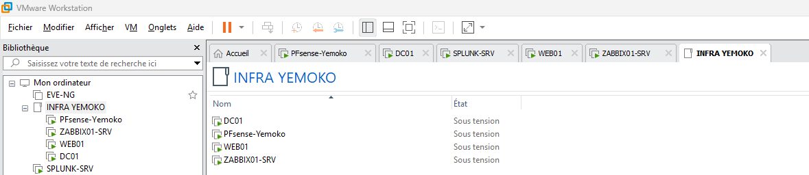
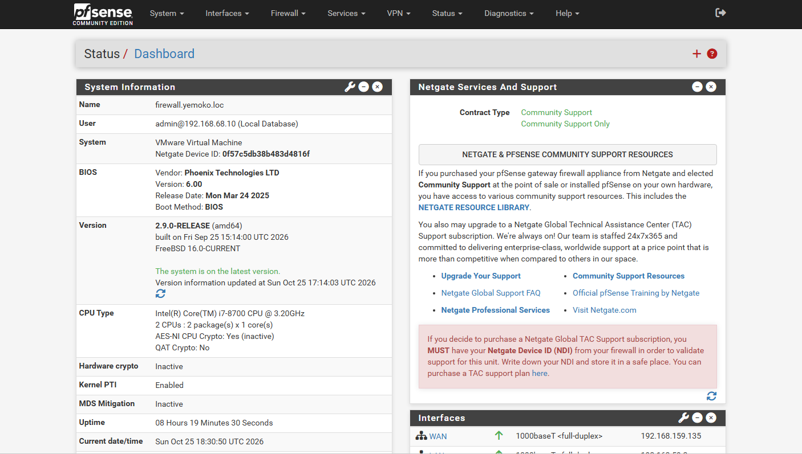
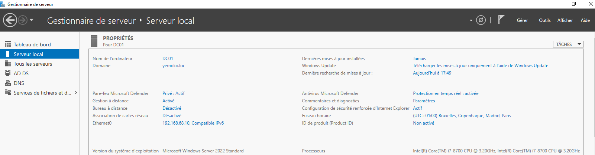
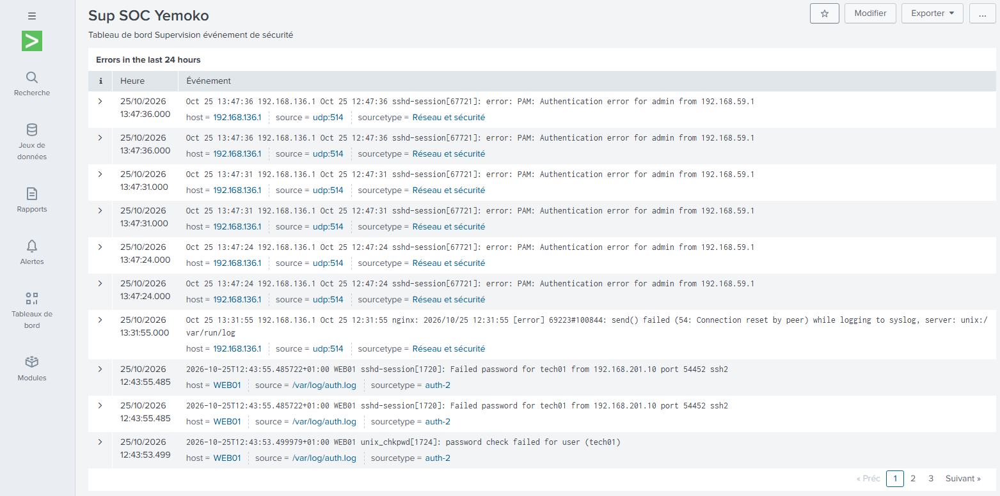
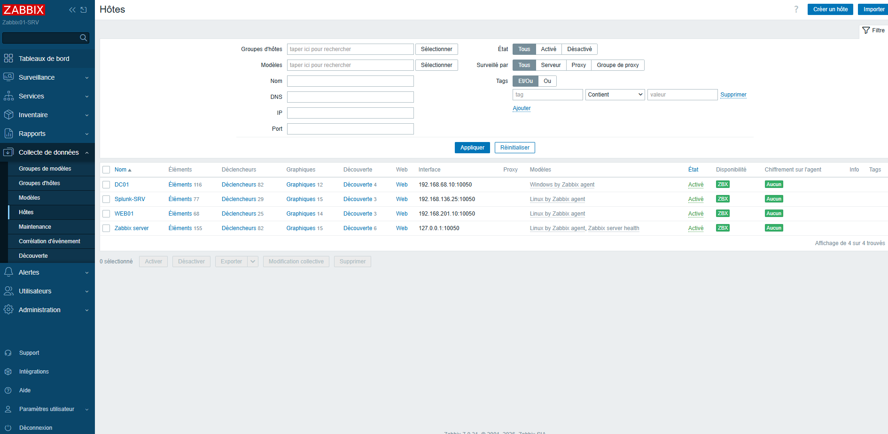
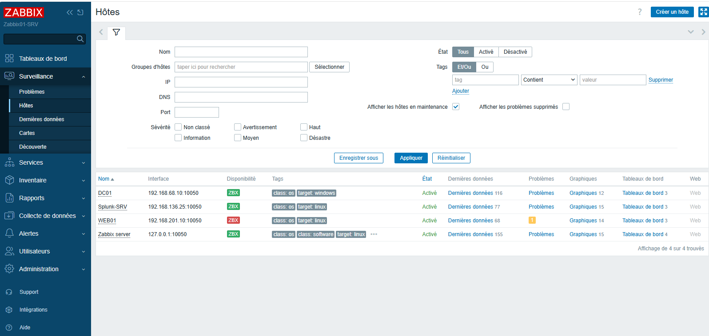
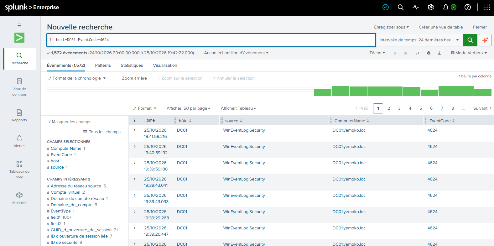
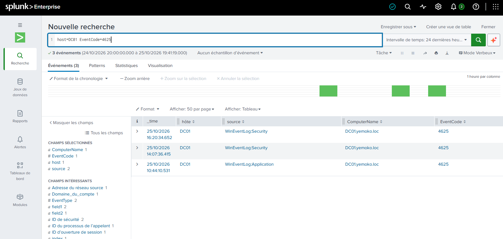

# 🛡️ YEMOKO SOC LAB

<p align="center">


</p>

## 📌 Présentation

**Yemoko SOC Lab** est une infrastructure virtuelle conçue pour développer des compétences en :

- Cyberdéfense
- Analyse SOC
- Supervision système
- Administration Windows/Linux
- Segmentation réseau
- Investigation de logs

L'objectif est de reproduire un environnement d'entreprise intégrant un SIEM (**Splunk**), une solution de supervision (**Zabbix**), un contrôleur de domaine (**Active Directory**) et un firewall (**pfSense**).

---

# 📚 Sommaire

- [Architecture](#-architecture)
- [Infrastructure virtuelle](#-infrastructure-virtuelle)
- [Segmentation réseau](#-segmentation-réseau)
- [Active Directory](#-active-directory)
- [Splunk Enterprise](#-splunk-enterprise)
- [Zabbix Monitoring](#-zabbix-monitoring)
- [Cas d'usage SOC](#-cas-dusage-soc)
- [Compétences démontrées](#-compétences-démontrées)
- [Améliorations futures](#-améliorations-futures)

---

# 🏗️ Architecture

```text
                         INTERNET
                              │
                        pfSense WAN
                              │

        ┌─────────────┬─────────────┬─────────────┐
        │             │             │             │

      LAN         SERVEURS        MGMT         DMZ
 192.168.59.0  192.168.68.0  192.168.136.0 192.168.201.0

                      │
                      │
         ┌────────────┴────────────┐
         │                         │

       DC01                     WEB01
 Active Directory          Apache + SSH

               └─────────────┬─────────────┘
                             │

                        SPLUNK-SRV

                             │

                       ZABBIX01-SRV
```

---

# 🖥️ Infrastructure virtuelle

## VMware Workstation



Machines virtuelles déployées :

| Machine | Rôle |
|----------|----------|
| pfSense-Yemoko | Firewall |
| DC01 | Active Directory |
| WEB01 | Serveur Web |
| SPLUNK-SRV | SIEM |
| ZABBIX01-SRV | Supervision |

---

# 🌐 Segmentation réseau

## Interfaces pfSense



| Réseau | Adresse |
|----------|----------|
| WAN | 192.168.159.0/24 |
| LAN | 192.168.59.0/24 |
| SERVEURS | 192.168.68.0/24 |
| WIFI | 192.168.75.0/24 |
| MGMT | 192.168.136.0/24 |
| DMZ | 192.168.201.0/24 |

---

# 🏢 Active Directory



### Services installés

```text
Active Directory Domain Services
DNS
Kerberos
Gestion des utilisateurs
```

### Domaine

```text
yemoko.loc
```

### Contrôleur de domaine

```text
DC01
192.168.68.10
```

---

# 🔎 Splunk Enterprise

## Sources de logs

### Windows

```text
DC01
WinEventLog Security
WinEventLog System
WinEventLog Application
```

### Linux

```text
WEB01
auth.log
Apache Access
Apache Error
SSH
```

### Réseau

```text
pfSense
Firewall Logs
DNS Logs
DHCP Logs
VPN Logs
```

---

# 🚨 Dashboard SOC



## KPI sécurité

- SSH Failures
- Firewall Blocks
- Windows Failed Logons
- Windows Successful Logons

## Graphiques

- SSH Failed Password Timeline
- Windows Authentication Activity
- Latest SSH Security Events

---

# 📊 Monitoring Zabbix



### Hôtes supervisés

```text
DC01
WEB01
SPLUNK-SRV
ZABBIX01-SRV
```

### Métriques surveillées

- CPU
- RAM
- Disque
- Réseau
- Disponibilité
- Services

---

## Validation de la supervision

Extinction volontaire de WEB01 :



Résultat :

```text
ZBX rouge
Agent indisponible
Détection correcte de la panne
```

✅ Supervision validée

---

# 🚨 Cas d'usage SOC

## Détection SSH

Simulation :

```bash
ssh tech01@192.168.201.10
```

Détection Splunk :

```spl
host=WEB01 "Failed password"
```

Résultat :

✅ Utilisateur ciblé identifié

✅ Adresse IP source identifiée

✅ Historique de connexion disponible

---

## Authentification Windows réussie

Recherche :

```spl
host=DC01 EventCode=4624
```



---

## Authentification Windows échouée

Recherche :

```spl
host=DC01 EventCode=4625
```



---

## Firewall pfSense

Recherche :

```spl
host="192.168.136.1"
```

Résultat :

```text
Firewall Events
SSHGuard
DNS
DHCP
VPN
```

---

# 🛠️ Technologies utilisées

### Réseau

- pfSense
- DNS
- DHCP
- NAT
- Routage

### Systèmes

- Windows Server 2022
- Debian 13

### SIEM

- Splunk Enterprise Free
- Splunk Universal Forwarder
- Syslog

### Supervision

- Zabbix

### Virtualisation

- VMware Workstation

---

# 🎯 Compétences démontrées

✅ Active Directory

✅ Administration Windows Server

✅ Linux Debian

✅ Apache

✅ SSH

✅ Splunk Enterprise

✅ SIEM

✅ Analyse de logs

✅ Investigation SOC

✅ Supervision Zabbix

✅ pfSense

✅ Segmentation réseau

✅ Routage

✅ Virtualisation VMware

---

# 🚀 Améliorations futures

- Déploiement Sysmon
- Création d'alertes Splunk avancées
- Corrélation multi-sources
- Intégration MITRE ATT&CK
- Déploiement Wazuh
- Création de playbooks SOC

---

## 👨‍💻 Auteur

**YEMOKO SOC LAB**

Projet personnel de cybersécurité conçu dans le cadre d'un perfectionnement en administration systèmes, supervision et analyse SOC.

⭐ N'hésitez pas à laisser une étoile au dépôt GitHub.
